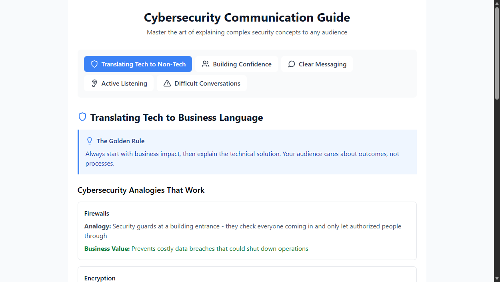

# Cybersecurity Communication Guide

An interactive web application designed to help cybersecurity professionals, startup founders, and IT experts effectively communicate complex technical concepts to non-technical audiences.

**Live demo:** https://claude.ai/public/artifacts/f62e576b-4645-4fc8-95a5-266f8aad5c2e



## 🎯 Purpose

Whether you're pitching to investors, presenting to clients, or explaining security concepts to your team, this guide provides practical tools and techniques to bridge the communication gap between technical expertise and business understanding.

## ✨ Features

- **Tech Translation Tools**: Ready-to-use analogies and business impact statements for common cybersecurity concepts
- **Interactive Learning**: Check off tips as you practice them with built-in progress tracking
- **Comprehensive Coverage**: Five key areas of professional communication
- **Real Examples**: Practical scenarios and proven techniques
- **Mobile Responsive**: Access your communication toolkit anywhere

## 🚀 What You'll Learn

### 1. Translating Tech to Business Language
- Convert technical jargon into relatable analogies
- Lead with business impact, not technical details
- Structure presentations for maximum clarity

### 2. Building Confidence
- Pre-presentation techniques that actually work
- Mindset shifts for better performance
- Physical techniques to reduce anxiety

### 3. Clear Messaging
- The headline-first approach
- Signpost phrases for better flow
- Checking for understanding

### 4. Active Listening
- Techniques for better audience engagement
- Reading the room effectively
- Adapting your communication style

### 5. Difficult Conversations
- Staying curious instead of defensive
- Finding common ground
- Reframing challenges as opportunities

## 🛠️ Technology Stack

- **Frontend**: React with Hooks
- **Styling**: Tailwind CSS (loaded from the Tailwind Play CDN in `public/index.html`)
- **Icons**: Lucide React
- **State Management**: React useState
- **Build**: Create React App (react-scripts 5); `npm run build` outputs a static site

## 📱 Live Demo

[View the Interactive Guide](https://claude.ai/public/artifacts/f62e576b-4645-4fc8-95a5-266f8aad5c2e) (hosted as a public Claude artifact)

## 🏃‍♂️ Quick Start

1. Clone the repository:
```bash
git clone https://github.com/glatinone/cybersecurity-communication-guide.git
cd cybersecurity-communication-guide
```

2. Install dependencies:
```bash
npm install
```

3. Start the development server:
```bash
npm start
```

4. Open your browser to `http://localhost:3000`

To build a static production bundle in `build/`:
```bash
npm run build
```

`npm run deploy` builds and pushes `build/` to a `gh-pages` branch for GitHub Pages (see `homepage` in `package.json`).

## 📁 Project Structure

```
cybersecurity-communication-guide/
├── src/
│   ├── components/
│   │   └── CommunicationGuide.jsx   # all guide content and UI
│   ├── App.css
│   ├── App.js
│   └── index.js
├── public/
│   └── index.html
├── docs/
│   └── screenshot.png
├── package.json
├── LICENSE
└── README.md
```

## 🎨 Customization

The guide is built with modularity in mind. You can easily:

- Add new communication scenarios
- Modify existing analogies for your industry
- Customize the progress tracking system
- Add new tip categories
- Integrate with your existing tools

## 💡 Use Cases

- **Startup Founders**: Pitch cybersecurity solutions to non-tech investors
- **Sales Engineers**: Explain complex security products to prospects
- **IT Leaders**: Communicate security needs to executive teams
- **Consultants**: Present findings to diverse client audiences
- **Educators**: Teach cybersecurity concepts effectively

## 🤝 Contributing

Contributions are welcome! Whether you have:
- New analogies that work well
- Additional communication scenarios
- UI/UX improvements
- Bug fixes or performance enhancements

Please feel free to:
1. Fork the repository
2. Create a feature branch (`git checkout -b feature/amazing-feature`)
3. Commit your changes (`git commit -m 'Add amazing feature'`)
4. Push to the branch (`git push origin feature/amazing-feature`)
5. Open a Pull Request

## 📋 Roadmap

- [ ] Add video examples for key concepts
- [ ] Integration with presentation tools (PowerPoint, Google Slides)
- [ ] Industry-specific customization options
- [ ] Advanced analytics for tracking improvement
- [ ] Community-contributed analogies database
- [ ] Multi-language support

## 📧 Feedback & Support

Have suggestions or found a bug? 
- Open an issue on GitHub
- Email: yeheskieltampubolon@gmail.com
- LinkedIn: [kiel-tampubolon](https://www.linkedin.com/in/kiel-tampubolon/)
- Website: [kielltampubolon.id](https://www.kielltampubolon.id/)

## 📄 License

This project is licensed under the MIT License - see the [LICENSE](LICENSE) file for details.

## 🙏 Acknowledgments

- Inspired by the challenges faced by cybersecurity professionals in communicating with diverse audiences
- Built for the community of technical experts who want to make their knowledge more accessible
- Special thanks to all the cybersecurity professionals who shared their communication challenges

---

⭐ **Found this helpful?** Give it a star to help others discover this resource!

**Built with ❤️ for the cybersecurity community**
